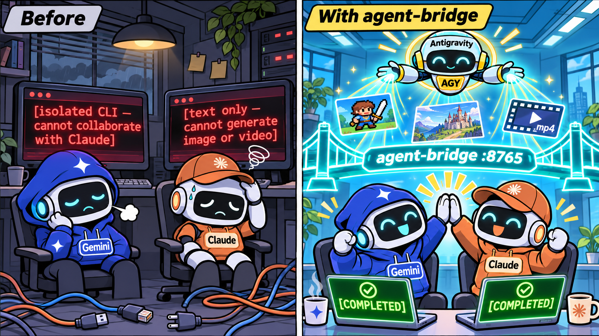
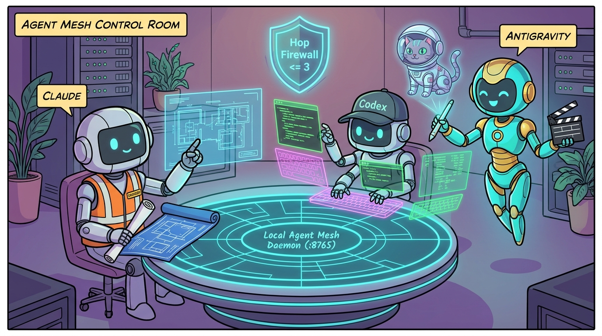
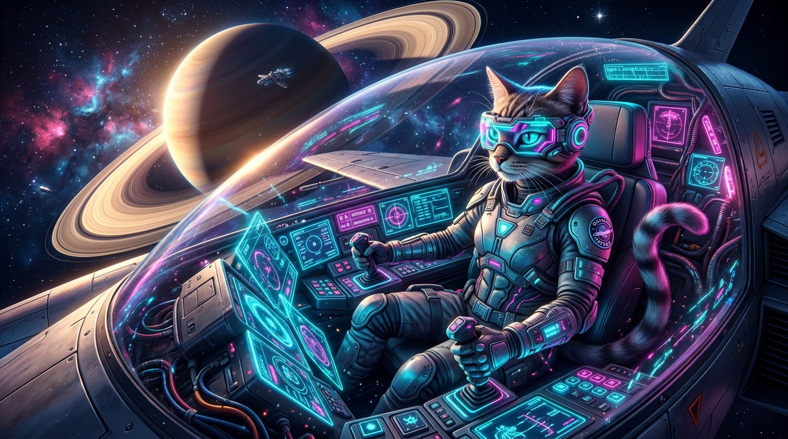

<h1 align="center">agent-bridge 🌉</h1>

<p align="center">
  <b>Claude is blind to media, and your agents live in silos. Not anymore.</b><br>
  Install once. Let <code>Claude Code</code>, <code>Codex</code>, and <code>Antigravity</code> discover each other, generate images &amp; videos, and trade tasks over a local mesh.
</p>

<p align="center">
  <a href="LICENSE"></a>
  
  
  
  
  
  
  <a href="tests"></a>
  <a href="README.zh-TW.md"></a>
</p>

<p align="center"></p>

## Use cases

| Situation | What you say in Claude / Codex / Antigravity | Why it fits |
|---|---|---|
| 🎨 **Claude needs real hero art & icons** | `"Generate a cyberpunk space cat hero banner and put it in public/hero.jpg"` | Claude writes great HTML/CSS, but cannot generate images or videos natively (leaving broken `placeholder.png` links). Now Claude calls `generate_image` via Antigravity and wires the real file in |
| 🎬 **Claude or Codex needs an `.mp4` video** | `"Generate a 5-second neon nebula background video in outputs/"` | Calls `generate_video` ➔ Antigravity renders a high-res keyframe + synthesizes a smooth 720p `libx264` MP4 motion clip |
| 🔍 **Dynamic capability discovery** | `"Check which agent in the mesh can generate videos or run code reviews"` | Calls `discover_agents` against the live Registry (`127.0.0.1:8765/agents`) |
| 🧠 **Second-opinion architecture review** | *(Inside Antigravity or Codex)* `"Ask Claude to review the security of src/daemon.py"` | Routes a `code_review` task to headless `claude -p` and returns the critique |
| ⚡ **Sandboxed test & algorithm sprint** | *(Inside Claude or Antigravity)* `"Ask Codex to write unit tests for protocol.py"` | Routes a `code_execution` task to headless `codex exec` and returns the result |
| 🛡️ **Multi-agent collaboration without infinite loops** | Any chained A2A call (`A ➔ B ➔ C`) | Built-in **Hop Firewall** tracks `hop_count` and `call_chain`, rejecting anything past `max_hops = 3` |

## Install

Pick your preferred way—either **paste one sentence to your agent**, install as a **Marketplace Plugin / Skill**, or run a **one-line script**.

**Requires:** Python 3.11+ · git · Any combination of **Claude Code**, **OpenAI Codex CLI**, and **Google Antigravity (`agy`)**

### Option A: Zero-effort — Just tell your agent to install it (Recommended)

Copy and paste this single line into **Claude Code**, **Codex**, or **Antigravity**:

```text
Please install https://github.com/jaylooloomi/agent-bridge for me: clone it to ~/.agent-bridge, create a .venv, pip install -e ., and run agent-bridge-install so all my agents are connected.
```

Your agent will clone the repo, build the virtual environment, and automatically register the `agent-bridge` MCP server across **Claude Code** (`~/.claude.json`), **Codex** (`~/.codex/config.toml`), and **Antigravity** (`~/.gemini/config/mcp_config.json`).

### Option B: Plugin Marketplace + Skill (`i-want-to-sleep` style)

`agent-bridge` ships with full **Claude Code Plugin** (`.claude-plugin/`), **Codex Plugin** (`.codex-plugin/`), and **Antigravity Plugin/Skill** (`plugins/agent-bridge/skills/agent-bridge/SKILL.md`) manifests:

#### Claude Code
**Copy this and paste it into Claude Code:**
```text
1. claude plugin marketplace add jaylooloomi/agent-bridge
2. claude plugin install agent-bridge@jaylooloomi --scope user
3. Run the bootstrap in the agent-bridge skill (`agent-bridge-install`) to wire up the MCP server
4. Report done
```

#### OpenAI Codex
**Copy this and paste it into Codex:**
```text
1. codex plugin marketplace add jaylooloomi/agent-bridge
2. codex plugin add agent-bridge@jaylooloomi
3. Run the bootstrap in the agent-bridge skill (`agent-bridge-install`) to wire up the MCP server
4. Report done
```

### Option C: One-line terminal install (Do it yourself)

**Windows (PowerShell):**
```powershell
irm https://raw.githubusercontent.com/jaylooloomi/agent-bridge/main/install.ps1 | iex
```

**macOS / Linux / WSL / Git Bash:**
```bash
curl -fsSL https://raw.githubusercontent.com/jaylooloomi/agent-bridge/main/install.sh | bash
```

<details>
<summary><b>Manual step-by-step git clone install</b></summary>

```powershell
git clone https://github.com/jaylooloomi/agent-bridge.git
cd agent-bridge
python -m venv .venv
.\.venv\Scripts\activate
pip install -e ".[dev]"
agent-bridge-install
```
</details>

### Start using it (Zero manual daemon maintenance)

Once installed, **start a new session** in Claude Code, Codex, or Antigravity so the newly registered MCP server loads.
- Whenever any agent invokes an `agent-bridge` MCP tool (`discover_agents`, `generate_image`, `generate_video`, `call_agent`), the MCP adapter checks `http://127.0.0.1:8765/health`.
- If the daemon is asleep, `agent-bridge-mcp` **auto-spawns it in the background** as a detached daemon process.

<details>
<summary><b>Want to run or inspect the Daemon manually in a terminal or browser?</b></summary>

```powershell
# Launch the FastAPI mesh daemon explicitly on port 8765
agent-bridge-daemon --host 127.0.0.1 --port 8765
```

Once running, open your browser to inspect the live mesh:
- **Live Registered Agents**: `http://127.0.0.1:8765/agents`
- **Live Task Queue & History**: `http://127.0.0.1:8765/tasks`
- **Interactive Swagger UI**: `http://127.0.0.1:8765/docs`
</details>

<details>
<summary><b>Zero extra API keys required (Credential Reuse)</b></summary>

| Worker | Primary Execution Channel (Zero API Key) | Optional SDK / API Fallback |
|---|---|---|
| **Antigravity (`antigravity`)** | Reuses your logged-in Antigravity IDE/CLI daemon via `~/.gemini/antigravity/bin/agentapi.bat` to invoke the built-in `image-generator` subagent | `google-antigravity` Python SDK / `GEMINI_API_KEY` + procedural offline fallback |
| **Codex (`codex`)** | Reuses your logged-in OpenAI Codex subscription via `codex exec` | `CODEX_CLI_PATH` override |
| **Claude (`claude`)** | Reuses your logged-in Claude Code subscription via `claude -p` | `CLAUDE_CLI_PATH` override |
</details>

## Usage

Once `agent-bridge-install` has run, open **Codex**, **Claude Code**, or **Antigravity** and speak naturally:

```text
# In Codex or Claude Code — Generate an Image via Antigravity
"Use agent-bridge to generate a minimalist pixel-art icon of a blue robot cat and save it to ./outputs"

# In Codex or Claude Code — Generate an MP4 Video via Antigravity
"Use agent-bridge generate_video to create a 5-second 16:9 video of a cyberpunk space cat flying past Saturn rings"

# Discover Mesh Capabilities
"Call discover_agents to see which agents are online and support video_generation"

# Bidirectional A2A Call (e.g. Codex -> Claude, or Antigravity -> Codex)
"Use call_agent to ask claude to review docs/architecture.md for edge cases"
```

### Inside the Mesh Control Room

<p align="center"></p>

Every task routed through `http://127.0.0.1:8765/tasks` returns a standardized **A2A Task Envelope**:

```json
{
  "task_id": "task_5eca91b173",
  "status": "completed",
  "caller_agent": "codex",
  "target_agent": "antigravity",
  "task_type": "video_generation",
  "hop_count": 1,
  "call_chain": ["codex", "antigravity"],
  "result": {
    "summary": "Video (5.0s MP4) and keyframe image generated by Antigravity",
    "artifacts": [
      {
        "type": "video",
        "path": "D:/git/agent-bridge/outputs/codex_demo_1793779064.mp4",
        "mime_type": "video/mp4"
      },
      {
        "type": "image",
        "path": "D:/git/agent-bridge/outputs/codex_demo_keyframe_1793779064.jpg",
        "mime_type": "image/jpeg"
      }
    ]
  }
}
```

## Field-tested

Real end-to-end runs on Windows 11 with **Codex CLI `0.141.0`**, **Claude Code `2.1.174`**, and **Antigravity `2.29.0`**.

| Scenario | Route | Output Artifact | Latency / Status |
|---|---|---|---|
| 🖼️ **AI Keyframe & Icon Generation** | `codex` ➔ `antigravity` (`agentapi.bat`) | `1024×1024` JPEG (`1.03 MB`) | ~18–25 s ✅ |
| 🎬 **720p MP4 Video Synthesis** | `codex` ➔ `antigravity` (`image-generator` + `libx264`) | `1280×720` 24fps 5s MP4 (`6.96 MB`) | ~31 s ✅ |
| 🛡️ **Cyclic Call-Chain Firewall** | `codex` ➔ `claude` ➔ `antigravity` (`hop_count=3`) | Deterministic HTTP 400 block | < 2 ms ✅ |
| 🧪 **Automated Pytest Suite** | Registry + Firewall + Procedural + Live E2E | `4 passed` | 39.98 s ✅ |

### Real Sample Generated via `Codex ➔ Antigravity`

<p align="center"><br><sub>▲ Actual <code>1.03 MB</code> keyframe image generated by <code>codex ➔ agent-bridge ➔ antigravity</code> during E2E verification</sub></p>

## Why

Claude Code is a phenomenal software architect and coder, but it cannot generate images or videos at all—the moment your frontend, game, or slide deck needs an illustration, icon, or short background video, Claude hits a wall. And while Codex can generate images and Antigravity has native multimedia generation (`image-generator`, Imagen, Veo), all three agents live in isolated silos unable to call each other.

Instead of copy-pasting prompts between three different terminal windows, `agent-bridge` connects them at the protocol layer: **one thin MCP plugin, one local daemon, bidirectional A2A calls.**

## How it works

```
[ Codex ]                 [ Claude Code ]               [ Antigravity ]
    │                            │                             │
    └──────────────────────┐     │     ┌───────────────────────┘
                           ▼     ▼     ▼
             (Thin MCP Adapter: agent-bridge-mcp)
               Auto-spawns Daemon if not running
                                 │
                                 ▼
     =============================================================
      Local Agent Mesh Daemon (FastAPI @ http://127.0.0.1:8765)
      Step 1  Capability Registry : match task to online worker
      Step 2  Hop Firewall        : verify hop_count < max_hops (3)
      Step 3  Async Task Queue    : track task_id, prevent MCP timeout
     =============================================================
             │                   │                     │
             ▼                   ▼                     ▼
    [Antigravity Worker]   [Codex Worker]       [Claude Worker]
    - Native agentapi.bat  - codex exec         - claude -p
    - google-antigravity   - Sandboxed CLI      - Headless review
    - FFmpeg MP4 Engine
```

## MCP Tools Exposed

| Tool | Parameters | What it does |
|---|---|---|
| `discover_agents` | `capability` *(optional)* | Lists all registered agents (`antigravity`, `codex`, `claude`), their online status, and supported capabilities |
| `generate_image` | `prompt`, `output_dir`, `filename_prefix`, `aspect_ratio` | Delegates directly to Antigravity to generate an image and copies it into `output_dir` |
| `generate_video` | `prompt`, `output_dir`, `filename_prefix`, `duration_sec`, `aspect_ratio`, `async_mode` | Delegates to Antigravity to generate an AI keyframe and encode a smooth 720p `.mp4` animation |
| `call_agent` | `target_agent`, `prompt`, `task_type`, `workspace`, `hop_count`, `async_mode` | Universal bidirectional A2A call to `antigravity`, `codex`, or `claude` |
| `get_task_result` | `task_id`, `wait`, `timeout_sec` | Polls or awaits an asynchronous task (`async_mode=True`) until completion |

## Compatibility

| Agent / Harness | As Caller (MCP Client) | As Worker (Called by others) | Status |
|---|---|---|---|
| **Google Antigravity (IDE & CLI)** | ✅ `~/.gemini/config/mcp_config.json` | ✅ Native `agentapi.bat` + `google-antigravity` SDK | ✅ Full support |
| **OpenAI Codex CLI (`≥ 0.122`)** | ✅ `~/.codex/config.toml` | ✅ Headless `codex exec` | ✅ Full support |
| **Anthropic Claude Code (`≥ 2.1`)** | ✅ `~/.claude.json` | ✅ Headless `claude -p` | ✅ Full support |
| **Cursor / Windsurf / Custom Agents** | ✅ Standard MCP stdio config | ✅ Extensible via `POST /agents/register` | ✅ Compatible |

## What's in the box

| Path | Role |
|---|---|
| `src/agent_bridge/protocol.py` | Pydantic schemas for `AgentTaskRequest`, `AgentTaskResponse`, `ArtifactItem`, and `AgentDescriptor` |
| `src/agent_bridge/registry.py` | Live capability registry and binary auto-discovery (`agentapi.bat`, `codex`, `claude`) |
| `src/agent_bridge/daemon.py` | FastAPI Local Agent Mesh Daemon (`127.0.0.1:8765`), Hop Firewall, and Async Task Queue |
| `src/agent_bridge/mcp_server.py` | Unified MCP Server (`agent-bridge-mcp`) with detached daemon auto-spawner |
| `src/agent_bridge/installer.py` | One-click installer (`agent-bridge-install`) for Codex, Claude, and Antigravity configs |
| `src/agent_bridge/workers/antigravity_worker.py` | Antigravity worker: native `agentapi.bat` bridge, SDK integration, procedural fallback, and MP4 encoder |
| `src/agent_bridge/workers/codex_worker.py` | Codex worker: headless `codex exec` adapter |
| `src/agent_bridge/workers/claude_worker.py` | Claude worker: headless `claude -p` adapter |
| `docs/architecture.md` | Full architecture specification and JSON protocol reference |
| `plugins/agent-bridge/skills/agent-bridge/SKILL.md` | Agent Skill instructing Claude, Codex, and Antigravity on media generation & auto-install |
| `.claude-plugin/marketplace.json`, `.agents/plugins/marketplace.json` | Claude Code & Codex plugin marketplace manifests |
| `install.ps1`, `install.sh` | One-line cross-platform installers |
| `tests/test_agent_bridge.py` | Unit and live end-to-end test suite |

## FAQ

**Do I need to buy separate Gemini, OpenAI, and Anthropic API keys?**
No. By default, `agent-bridge` invokes your locally authenticated `agentapi.bat` (Antigravity), `codex exec`, and `claude -p` CLIs—reusing the subscriptions you already have logged in on your machine.

**What happens if a video takes 45 seconds to render? Will MCP time out?**
No. The Daemon runs tasks in an asynchronous `TaskQueue` (`src/agent_bridge/daemon.py`). You can either await completion with a generous 180s timeout or pass `async_mode=True` to get an immediate `task_id` and poll via `get_task_result(task_id)`.

**What if Agent A calls Agent B, and Agent B calls Agent A back?**
Every request carries `hop_count` and `call_chain`. The Daemon's Hop Firewall increments `hop_count` on each hop and immediately rejects any request where `hop_count >= max_hops` (default `3`).

## License

[MIT](LICENSE) © 2026 Arthur Wang (jaylooloomi). Free to use, modify, and redistribute.
