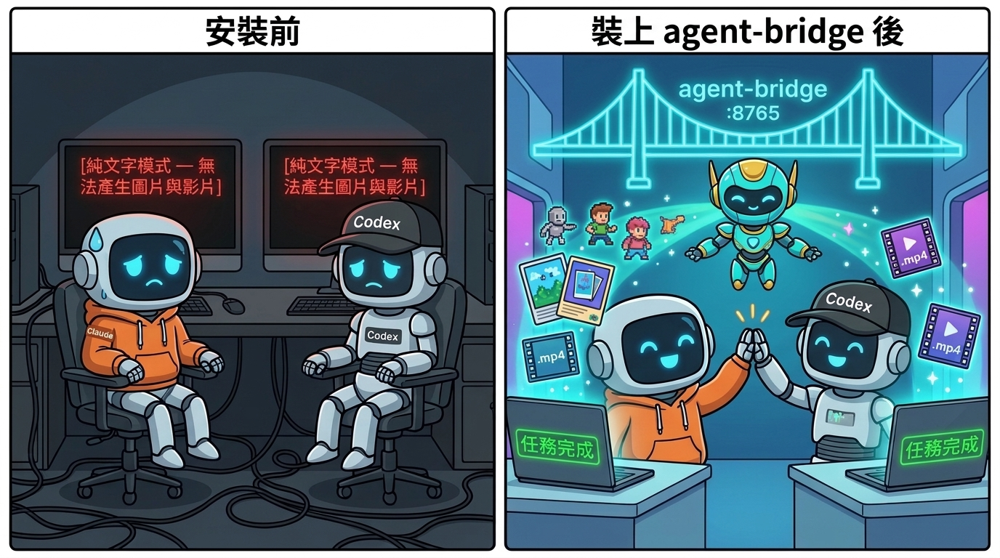
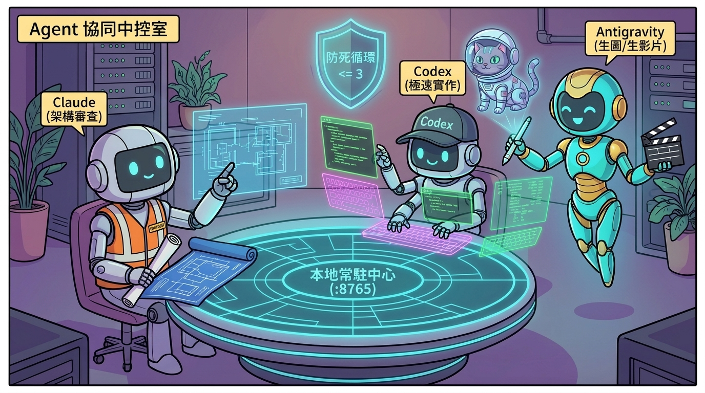

<h1 align="center">agent-bridge 🌉</h1>

<p align="center">
  <b>讓你的 AI 寫程式助手不再是「多媒體盲人」。</b><br>
  安裝一次，讓 <code>Codex</code>、<code>Claude Code</code> 與 <code>Antigravity</code> 透過本地匯流排互相發現、直接生圖生影片、雙向協同幹活。
</p>

<p align="center">
  <a href="LICENSE"></a>
  
  
  
  
  
  
  <a href="tests"></a>
  <a href="README.md"></a>
</p>

<p align="center"></p>

## 使用情境

| 情境 | 在 Codex / Claude / Antigravity 怎麼說 | 為什麼適合 |
|---|---|---|
| 🎨 **做網頁、做遊戲缺主視覺圖與 Icon** | `「幫我用 agent-bridge 畫一張賽博龐克太空貓主視覺，存到 public/hero.jpg」` | Claude 與 Codex 很會寫前端，但以前只能塞假圖連結；現在直接呼叫 Antigravity 產出真圖並自動寫入程式碼 |
| 🎬 **Landing Page 或簡報需要動態短片 (`.mp4`)** | `「呼叫 generate_video 幫我產生一段 5 秒的太空貓飛行背景影片」` | 自動喚起 Antigravity 產生高畫質關鍵影格，並透過 `libx264` 合成平滑運鏡的 720p `.mp4` 影片 |
| 🔍 **動態查詢誰有什麼能力** | `「查詢目前在線有哪些 Agent 支援 video_generation 或 code_review」` | 呼叫 `discover_agents` 即時查詢常駐註冊表 (`127.0.0.1:8765/agents`) |
| 🧠 **跨 Agent 架構審查 (Second Opinion)** | *(在 Antigravity 或 Codex 內)* `「請呼叫 Claude 幫我審查 src/daemon.py 的安全性」` | 透過無頭模式 `claude -p` 調度 Claude 進行深度 Code Review 並回傳結果 |
| ⚡ **沙盒測試與演算法衝刺** | *(在 Claude 或 Antigravity 內)* `「請呼叫 Codex 幫 protocol.py 補齊測試」` | 透過無頭模式 `codex exec` 調度 Codex 快速實作並回傳輸出 |
| 🛡️ **多代理互叫防死循環** | 任何跨 Agent 連鎖調用 (`A ➔ B ➔ C`) | 內建 **Hop Firewall** 追蹤 `hop_count` 與 `call_chain`，超過 `max_hops = 3` 立即阻擋 |

## 安裝

一行指令，同時把 **Codex**、**Claude Code** 與 **Antigravity** 接進同一個本地 Agent 匯流排。

**需求：** Python 3.11+ · git · 本機已安裝 **Antigravity (`agy`)**、**OpenAI Codex CLI**、**Claude Code CLI**（任選或全裝皆可）

### 1. 下載並安裝套件

```powershell
git clone https://github.com/jaylooloomi/agent-bridge.git
cd agent-bridge
python -m venv .venv
.\.venv\Scripts\activate
pip install -e ".[dev]"
```

### 2. 一鍵註冊至三大 Agent

```powershell
agent-bridge-install
```

執行後會自動將 `agent-bridge` MCP 寫入三個工具的設定檔：
- **Antigravity** (`~/.gemini/config/mcp_config.json`)
- **OpenAI Codex** (`~/.codex/config.toml`)
- **Claude Code** (`~/.claude.json`)

### 3. 直接開始使用（具備自癒式自動啟動）

你**不需要**每次開機都手動去開背景伺服器：
- 當你在 Codex 或 Claude 呼叫任何 `agent-bridge` 工具時，MCP Client 會先檢查 `http://127.0.0.1:8765/health`。
- 如果常駐 Daemon 還沒跑起來，`agent-bridge-mcp` 會**自動在背景以獨立程序 (`DETACHED_PROCESS`) 喚醒 Daemon**。

<details>
<summary><b>想要手動啟動 Daemon 或用瀏覽器監控任務佇列？</b></summary>

```powershell
# 手動在前台或背景啟動 FastAPI 常駐中心
agent-bridge-daemon --host 127.0.0.1 --port 8765
```

啟動後，打開瀏覽器即可即時查看：
- **在線 Agent 能力註冊表**：`http://127.0.0.1:8765/agents`
- **任務佇列與歷史紀錄**：`http://127.0.0.1:8765/tasks`
- **互動式 Swagger API 測試面板**：`http://127.0.0.1:8765/docs`
</details>

<details>
<summary><b>免重複申請 API Key（直接複用本機登入憑證）</b></summary>

| 目標 Worker | 預設執行通道（免額外 API Key） | 備援通道 |
|---|---|---|
| **Antigravity (`antigravity`)** | 直接透過本機已登入的 `~/.gemini/antigravity/bin/agentapi.bat` 喚起內建 `image-generator` 子代理 | `google-antigravity` Python SDK (`GEMINI_API_KEY`) ＋ 本地程序化生成引擎兜底 |
| **Codex (`codex`)** | 直接調用本機已登入的 `codex exec` CLI | 可透過 `CODEX_CLI_PATH` 指定路徑 |
| **Claude (`claude`)** | 直接調用本機已登入的 `claude -p` CLI | 可透過 `CLAUDE_CLI_PATH` 指定路徑 |
</details>

## 使用方式

執行完 `agent-bridge-install` 後，打開 **Codex**、**Claude Code** 或 **Antigravity** 直接用自然語言下令：

```text
# 在 Codex 或 Claude Code 中 —— 呼叫 Antigravity 生圖
「請透過 agent-bridge 幫我呼叫 Antigravity 畫一張藍色機械貓的像素風 Icon，存到 ./outputs」

# 在 Codex 或 Claude Code 中 —— 呼叫 Antigravity 生影片 (.mp4)
「請使用 generate_video 幫我產生一段 5 秒 16:9 的賽博龐克太空貓飛越土星環的動態短片」

# 探索目前在線的 Agent 能力
「呼叫 discover_agents 看看誰支援 video_generation」

# 雙向互叫（例如 Codex 叫 Claude，或 Antigravity 叫 Codex）
「使用 call_agent 請 claude 幫我檢查 docs/architecture.md 有沒有潛在漏洞」
```

### Agent Mesh 協同中控室

<p align="center"></p>

每一筆透過 `http://127.0.0.1:8765/tasks` 派發的任務，都會回傳標準化的 **A2A 任務結果封包**：

```json
{
  "task_id": "task_5eca91b173",
  "status": "completed",
  "caller_agent": "codex",
  "target_agent": "antigravity",
  "task_type": "video_generation",
  "hop_count": 1,
  "call_chain": ["codex", "antigravity"],
  "result": {
    "summary": "Video (5.0s MP4) and keyframe image generated by Antigravity",
    "artifacts": [
      {
        "type": "video",
        "path": "D:/git/agent-bridge/outputs/codex_demo_1793779064.mp4",
        "mime_type": "video/mp4"
      },
      {
        "type": "image",
        "path": "D:/git/agent-bridge/outputs/codex_demo_keyframe_1793779064.jpg",
        "mime_type": "image/jpeg"
      }
    ]
  }
}
```

## 實戰驗證

於 Windows 11 實機環境（**Codex CLI `0.141.0`**、**Claude Code `2.1.174`**、**Antigravity `2.29.0`**）端對端實測數據：

| 測試場景 | 調用路徑 | 實際產出檔案 | 耗時 / 結果 |
|---|---|---|---|
| 🖼️ **AI 主視覺與圖示生成** | `codex` ➔ `antigravity` (`agentapi.bat`) | `1024×1024` JPEG (`1.03 MB`) | ~18–25 秒 ✅ |
| 🎬 **720p MP4 動態短片合成** | `codex` ➔ `antigravity` (`image-generator` + `libx264`) | `1280×720` 24fps 5秒 MP4 (`6.96 MB`) | ~31 秒 ✅ |
| 🛡️ **防死循環 Hop 防火牆** | `codex` ➔ `claude` ➔ `antigravity` (`hop_count=3`) | 確定性 HTTP 400 攔截 | < 2 毫秒 ✅ |
| 🧪 **Pytest 自動化測試套件** | Registry + Firewall + Procedural + 真實 E2E | `4 passed` | 39.98 秒 ✅ |

### 實機透過 `Codex ➔ Antigravity` 產出之樣本圖

<p align="center"><br><sub>▲ 實機驗證期間由 <code>codex ➔ agent-bridge ➔ antigravity</code> 真實產出之 <code>1.03 MB</code> 圖片</sub></p>

## 為什麼做這個

Claude Code 和 OpenAI Codex 寫程式極強，但只要你的網頁、遊戲或簡報需要一張插圖、Icon 或一段 5 秒的背景動態影片，它們就只能兩手一攤給你一個 `placeholder.png`；與此同時，Google Antigravity 內建了強大的多媒體生成工具（`image-generator`、Imagen、Veo），而且三大工具各自在架構推理、沙盒執行與超大上下文各有專精。

與其在三個視窗之間手動複製貼上，不如裝一個 `agent-bridge`：**一個薄層 MCP 外掛 ＋ 一個本地常駐 Daemon，讓三大 Agent 直接在協定層雙向對話。**

## 運作方式

```
[ Codex ]                 [ Claude Code ]               [ Antigravity ]
    │                            │                             │
    └──────────────────────┐     │     ┌───────────────────────┘
                           ▼     ▼     ▼
             (統一薄層外掛：agent-bridge-mcp)
               若 Daemon 未啟動則自動於背景喚醒
                                 │
                                 ▼
     =============================================================
      Local Agent Mesh Daemon (FastAPI @ http://127.0.0.1:8765)
      Step 1  Capability Registry : 依能力匹配在線 Worker
      Step 2  Hop Firewall        : 檢查 hop_count < max_hops (3)
      Step 3  Async Task Queue    : 追蹤 task_id，防止長任務 Timeout
     =============================================================
             │                   │                     │
             ▼                   ▼                     ▼
    [Antigravity Worker]   [Codex Worker]       [Claude Worker]
    - 原生 agentapi.bat     - codex exec         - claude -p
    - google-antigravity   - 沙盒自動化執行      - 無頭架構審查
    - FFmpeg MP4 引擎
```

## 暴露的 MCP 工具

| 工具名稱 | 參數 | 作用 |
|---|---|---|
| `discover_agents` | `capability` *(選填)* | 查詢在線 Agent（`antigravity`、`codex`、`claude`）及其狀態與支援能力 |
| `generate_image` | `prompt`, `output_dir`, `filename_prefix`, `aspect_ratio` | 直接委派 Antigravity 產生圖片並複製到指定的 `output_dir` |
| `generate_video` | `prompt`, `output_dir`, `filename_prefix`, `duration_sec`, `aspect_ratio`, `async_mode` | 委派 Antigravity 產生 AI 關鍵影格並合成 720p `.mp4` 動態短片 |
| `call_agent` | `target_agent`, `prompt`, `task_type`, `workspace`, `hop_count`, `async_mode` | 通用雙向 A2A 調用，可呼叫任一目標 Agent 執行任務 |
| `get_task_result` | `task_id`, `wait`, `timeout_sec` | 查詢或等待非同步任務（`async_mode=True`）完成並取得產出路徑 |

## 相容性

| 執行環境 | 作為呼叫方 (Caller) | 作為被呼叫方 (Worker) | 狀態 |
|---|---|---|---|
| **Google Antigravity (IDE & CLI)** | ✅ `~/.gemini/config/mcp_config.json` | ✅ 原生 `agentapi.bat` + `google-antigravity` SDK | ✅ 完整支援 |
| **OpenAI Codex CLI (`≥ 0.122`)** | ✅ `~/.codex/config.toml` | ✅ 無頭模式 `codex exec` | ✅ 完整支援 |
| **Anthropic Claude Code (`≥ 2.1`)** | ✅ `~/.claude.json` | ✅ 無頭模式 `claude -p` | ✅ 完整支援 |
| **Cursor / Windsurf / 自訂腳本** | ✅ 標準 MCP stdio 掛載 | ✅ 可透過 `POST /agents/register` 動態擴充 | ✅ 相容 |

## 內容物

| 路徑 | 作用 |
|---|---|
| `src/agent_bridge/protocol.py` | 標準 A2A JSON Schema (`AgentTaskRequest`、`AgentTaskResponse`、`ArtifactItem`、`AgentDescriptor`) |
| `src/agent_bridge/registry.py` | 能力註冊表與本機 CLI 自動偵測 (`agentapi.bat`、`codex`、`claude`) |
| `src/agent_bridge/daemon.py` | FastAPI 常駐守護進程 (`127.0.0.1:8765`)、Hop 防火牆與非同步任務佇列 |
| `src/agent_bridge/mcp_server.py` | 統一 MCP Server (`agent-bridge-mcp`)，內建背景 Daemon 自動喚醒機制 |
| `src/agent_bridge/installer.py` | 一鍵安裝器 (`agent-bridge-install`)，自動寫入三大 Agent 設定檔 |
| `src/agent_bridge/workers/antigravity_worker.py` | Antigravity 執行器：原生 `agentapi.bat` 橋接、SDK 支援、離線兜底與 MP4 影片合成引擎 |
| `src/agent_bridge/workers/codex_worker.py` | Codex 執行器：封裝 `codex exec` 無頭執行模式 |
| `src/agent_bridge/workers/claude_worker.py` | Claude 執行器：封裝 `claude -p` 無頭推理模式 |
| `docs/architecture.md` | 系統架構設計圖與通訊協定規格書 |
| `tests/test_agent_bridge.py` | 單元測試與真實 Antigravity 端對端整合測試 |

## 常見問題

**我需要額外去買 Gemini、OpenAI、Anthropic 的 API Key 嗎？**
不用。`agent-bridge` 預設直接調用你本機已經登入好的 `agentapi.bat`（Antigravity）、`codex exec` 與 `claude -p`，100% 沿用你現有的訂閱額度。

**生影片如果要跑 30～40 秒，MCP 工具會不會 Timeout？**
不會。Daemon 內建非同步 `TaskQueue`，除了支援長連線等待外，也可以傳入 `async_mode=True` 立刻拿回 `task_id`，再透過 `get_task_result(task_id)` 取得最終影片路徑。

**如果 Agent A 叫 B、B 又反過來叫 A 怎麼辦？**
每個請求都帶有 `hop_count` 與 `call_chain`。Daemon 的防火牆會在每次轉發時遞增 `hop_count`，一旦達到 `max_hops`（預設 3 跳）就會立刻阻擋，不會產生無限迴圈。

## 授權

[MIT](LICENSE) © 2026 Arthur Wang (jaylooloomi)。可自由使用、修改與再散布。
