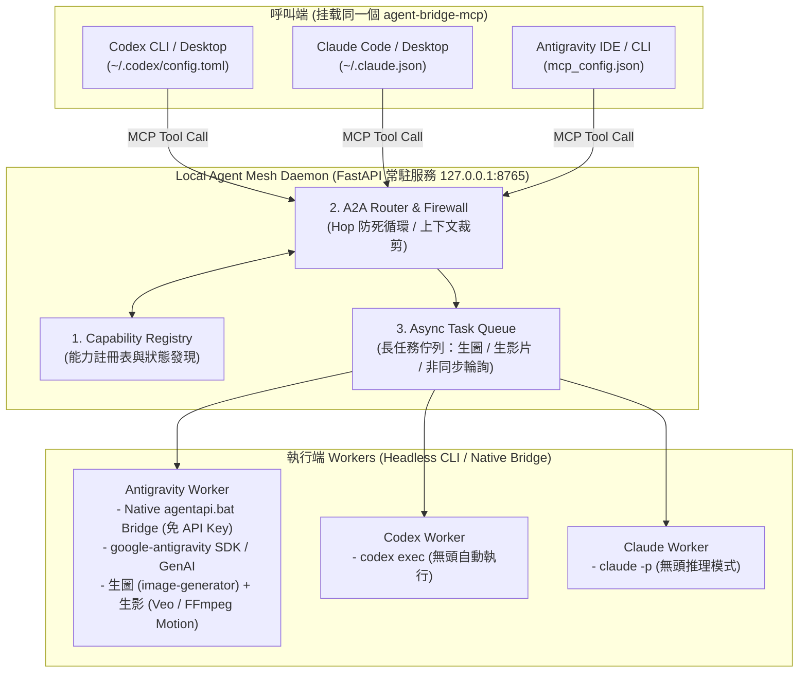

# Agent Bridge — Local Agent Mesh Daemon (方案三架構與通訊協定規格書)

## 1. 系統目標與定位

**Agent Bridge** 是一個本地常駐的 **A2A (Agent-to-Agent) 即時通訊匯流排與任務調度中心 (Local Agent Mesh Daemon)**，搭配一個極輕量的 **統一 MCP 客戶端 (`agent-bridge-mcp`)**。

只要在 **Codex**、**Claude**、**Antigravity** 中掛載同一個 `agent-bridge-mcp`，這三個 Agent 就能：
1. **動態發現彼此能力 (`discover_agents`)**：例如 Codex 或 Claude 發現自己無法產生圖片與影片，查詢後得知 `antigravity` 具備 `image_generation` 與 `video_generation` 能力。
2. **雙向同步/非同步呼叫 (`call_agent`, `wait_for_task`, `get_task_result`)**：
   - **Codex / Claude ➔ Antigravity**：自動透過本機已登入的 Antigravity Daemon (`agentapi.bat`) 或 `google-antigravity` SDK 喚起 `image-generator` 產生高畫質圖片（`.jpg`/`.png`）與動態短片（`.mp4`/`.webm`），並將產出檔案直接複製到專案目錄回傳給呼叫端。
   - **Antigravity / Claude ➔ Codex**：透過本機 `codex exec` 無頭模式執行沙盒實作、測試或演算法重構。
   - **Antigravity / Codex ➔ Claude**：透過本機 `claude -p` 無頭模式執行架構審查、前端設計或深度推理。
3. **防死循環與安全防護 (Firewall & Hop Guard)**：內建 `hop_count` 與 `max_hops`（預設最多 3 跳）及 `call_chain` 追蹤，徹底杜絕 Agent A 叫 B、B 又叫 A 的無限迴圈。

---

## 2. 系統架構圖 (Architecture Diagram)



---

## 3. 標準 A2A 通訊協定 (JSON Schema)

### 3.1 任務請求 Payload (`AgentTaskRequest`)

```json
{
  "caller_agent": "codex",
  "target_agent": "antigravity",
  "task_type": "image_generation",
  "prompt": "A cyberpunk space cat wearing neon goggles, pixel art style",
  "output_dir": "d:/git/agent-bridge/outputs",
  "parameters": {
    "aspect_ratio": "16:9",
    "duration_sec": 5,
    "filename_prefix": "space_cat"
  },
  "context": {
    "workspace": "d:/git/agent-bridge",
    "files": []
  },
  "hop_count": 0,
  "max_hops": 3,
  "call_chain": ["codex"],
  "async_mode": false
}
```

### 3.2 任務狀態與回應 Payload (`AgentTaskResponse`)

```json
{
  "task_id": "task_9f8e7d6c",
  "status": "completed",
  "caller_agent": "codex",
  "target_agent": "antigravity",
  "task_type": "image_generation",
  "hop_count": 1,
  "call_chain": ["codex", "antigravity"],
  "result": {
    "summary": "Image generated successfully via Antigravity native bridge.",
    "artifacts": [
      {
        "type": "image",
        "path": "D:/git/agent-bridge/outputs/space_cat_1793778585.jpg",
        "mime_type": "image/jpeg"
      }
    ],
    "raw_output": "..."
  },
  "error": null,
  "created_at": "2026-11-04T15:50:00+08:00",
  "completed_at": "2026-11-04T15:50:25+08:00"
}
```

---

## 4. MCP 暴露的核心工具清單 (`agent-bridge-mcp`)

任何掛載此 MCP Server 的 Agent 都可直接調用以下 5 個工具：

| 工具名稱 | 用途說明 |
| :--- | :--- |
| `discover_agents` | 查詢目前在線的 Agent 清單與其支援的能力（例如篩選 `capability="image_generation"` 或 `"video_generation"`）。 |
| `generate_image` | **(便捷專項工具)** 直接委派具備繪圖能力的 Agent（預設為 `antigravity`）產生圖片並儲存至指定路徑。 |
| `generate_video` | **(便捷專項工具)** 直接委派具備影片能力的 Agent（預設為 `antigravity`）產生動態短片（`.mp4`），支援多關鍵影格或高品質動態運鏡合成。 |
| `call_agent` | **(通用雙向 A2A 工具)** 呼叫任一目標 Agent（`antigravity` / `codex` / `claude`）執行任意任務（生圖、生影片、寫程式、Code Review），支援同步等待與非同步佇列。 |
| `get_task_result` | 查詢或等待非同步任務（`task_id`）的執行進度與最終產出檔案路徑。 |

---

## 5. 自癒式常駐啟動機制 (Auto-Start Daemon)

為了讓使用者體驗達到「裝上就能用、免手動維護背景視窗」，`agent-bridge-mcp` 內建 **Daemon 自動喚醒機制 (Auto-Spawn)**：
- 當 Codex 或 Claude 啟動並拉起 `agent-bridge-mcp` 時，MCP Client 會先檢查 `http://127.0.0.1:8765/health`。
- 若發現 Daemon 尚未啟動，MCP Client 會在背景以獨立脫離程序 (`DETACHED_PROCESS`) 自動啟動 `agent_bridge.daemon`，確保所有 Agent 共享同一個常駐註冊表與任務佇列！
